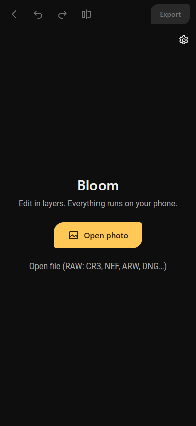
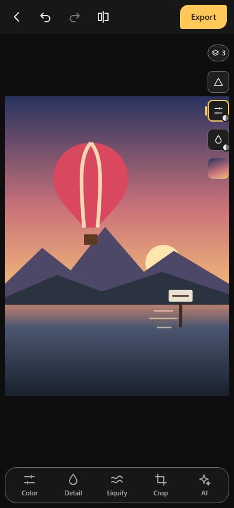
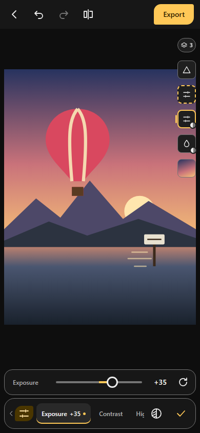
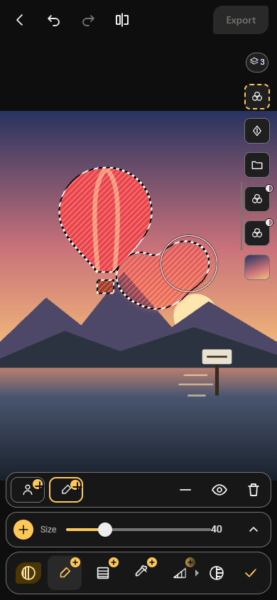

<p align="center"></p>

# Bloom

Free, open-source Android photo editor with on-device AI (selection, masking, color, blur, sharpen, liquify, object eraser). Optional cloud tier for advanced AI.

- Plan, milestones, features and decisions: [`docs/PLAN.md`](docs/PLAN.md)
- UI spec: [`design/UI.md`](design/UI.md)

## Design

The first design, as a clickable mockup: [`design/mockup.html`](design/mockup.html) ([open it in the browser](https://htmlpreview.github.io/?https://github.com/timothyhalim/bloom/blob/main/design/mockup.html)). The app has moved on since (icon tool bars, one settings box per tool), but the layout and flow are the same.

<p align="center">
  
  
  
  
</p>

## AI models

All run on the phone through MNN. Each is downloaded the first time a tool needs it (from `models/` in this repo) and checked against its SHA-256 in [`app/src/main/assets/models.json`](app/src/main/assets/models.json).

| Used for | Model | License | Source | File |
|---|---|---|---|---|
| Subject / Background mask | IS-Net general use (DIS) | Apache-2.0 | [rembg release](https://github.com/danielgatis/rembg/releases/download/v0.0.0/isnet-general-use.onnx) | `isnet_w8.mnn` (8-bit weights, 44 MB) |
| Tap to select an object | MobileSAM encoder + SAM decoder | Apache-2.0 | [Acly/MobileSAM](https://huggingface.co/Acly/MobileSAM) | `mobilesam_encoder_w8.mnn`, `mobilesam_decoder_w8.mnn` (8-bit, 11 + 9 MB) |
| Depth for lens blur and depth masks | Depth Anything V2 Small | Apache-2.0 (only the Small model is) | [onnx-community/depth-anything-v2-small](https://huggingface.co/onnx-community/depth-anything-v2-small) | `depth_anything_v2_small_w8.mnn` (8-bit, 27 MB) |
| AI eraser | Big LaMa | Apache-2.0 | [Carve/LaMa-ONNX](https://huggingface.co/Carve/LaMa-ONNX) | `lama_f16.mnn` (half precision, 105 MB; in two parts because GitHub limits files to 100 MB) |
| Upscale 2× / 4× | Real-ESRGAN general x4v3 | BSD-3-Clause | [xinntao/Real-ESRGAN release](https://github.com/xinntao/Real-ESRGAN/releases/download/v0.2.5.0/realesr-general-x4v3.pth) (exported to ONNX from the official weights) | `realesr_x4v3_f16.mnn` (half precision, 2.5 MB) |
| Person mask, background swap | Robust Video Matting, MobileNetV3 | GPL-3.0 | [PeterL1n/RobustVideoMatting release](https://github.com/PeterL1n/RobustVideoMatting/releases/download/v1.0.0/rvm_mobilenetv3_fp32.onnx) | `rvm_mobilenetv3_f16.mnn` (half precision, 7.6 MB) |

Each was converted from ONNX with MNN's converter. LaMa keeps half-precision weights because 8-bit weights break its Fourier layers; Real-ESRGAN and RVM keep them because 8-bit weights drift about 10× further from the original for 1–3 MB saved (see [docs/eval/m85-models.md](docs/eval/m85-models.md)).

## License

GPL-3.0, see [`LICENSE`](LICENSE).

Bundled libraries:

| Library | Version | License | Used for |
|---|---|---|---|
| [LibRaw](https://www.libraw.org) | 0.22.3 | LGPL-2.1 ([`COPYRIGHT`](app/src/main/cpp/libraw/COPYRIGHT)) | camera raw files |
| [MNN](https://github.com/alibaba/MNN) | 3.6.2 | Apache-2.0 | on-device AI |

The models keep their own licenses (table above).

## Build

Requires Android Studio (bundled JDK + Android SDK 37).

```
./gradlew assemblePlayDebug      # or assembleFdroidDebug
./gradlew testPlayDebugUnitTest
./gradlew connectedPlayDebugAndroidTest   # GPU tests, needs a device or emulator
```

Min Android 8.0 (API 26), OpenGL ES 3.0.
